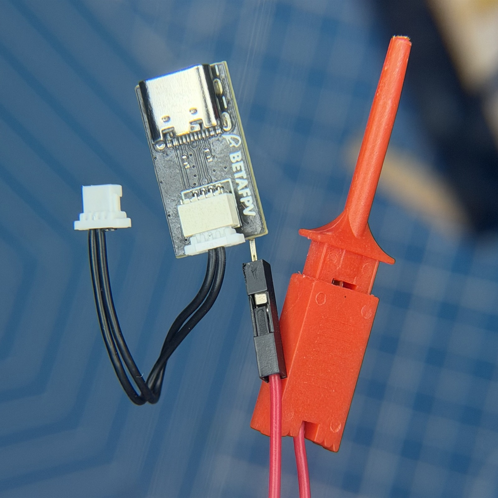
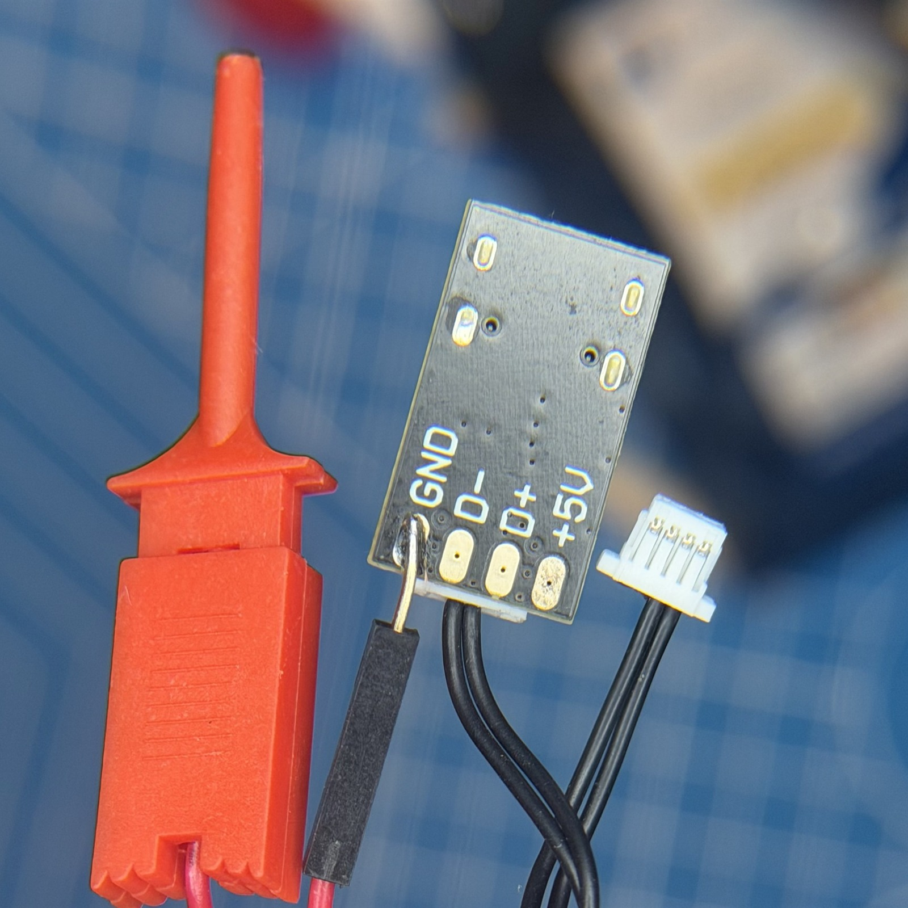
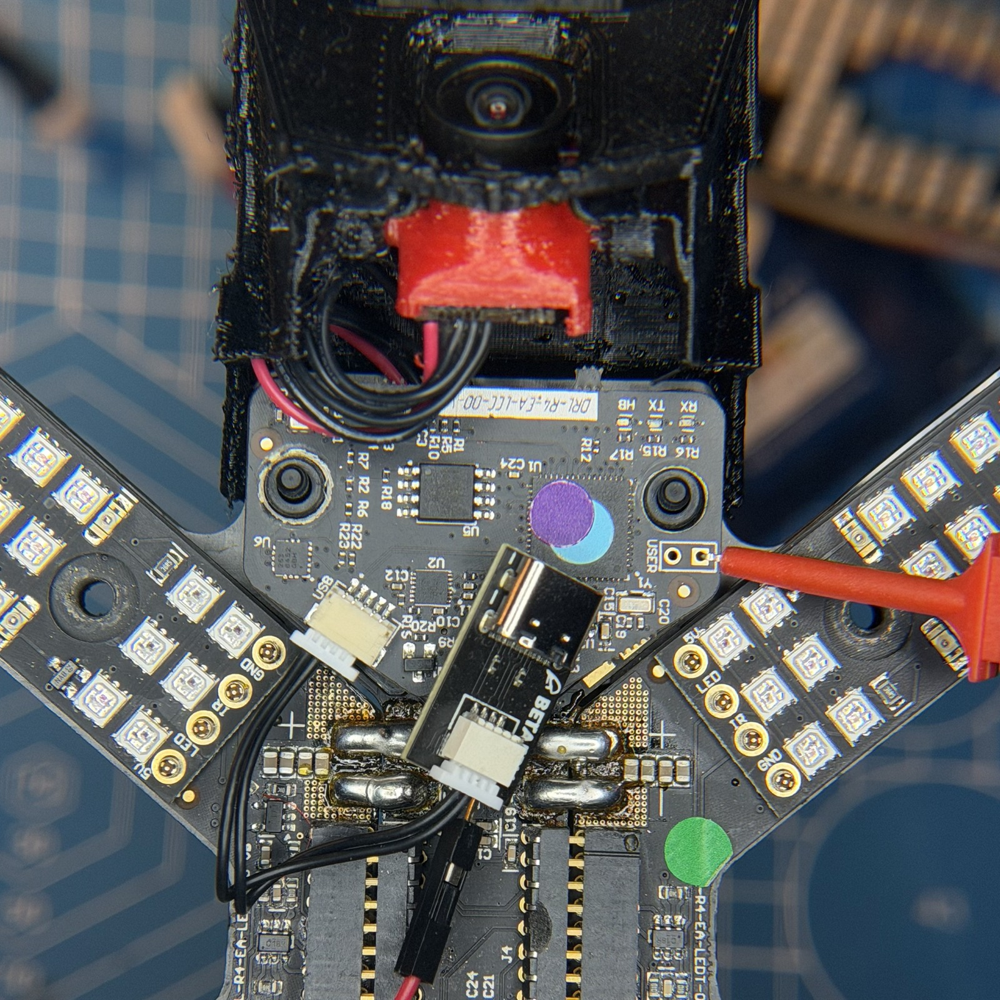
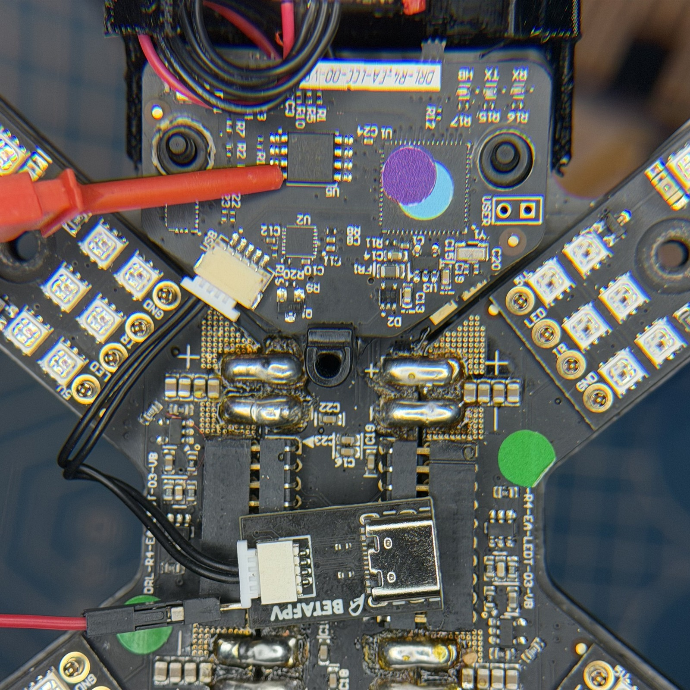

# DRL Racer4

Custom firmware and tools for the DRL Racer4 developed by [@leszczy](https://github.com/hackrfstuff), [@Mr-milky-way](https://github.com/Mr-milky-way), [@ZionFPV](https://github.com/ZionFPV), [@MayanHawk](https://github.com/MayanHawk).

Firmware for the F4 and F7 flight controllers, EC and LED controllers, with Betaflight OSD, LED patterns and GIF uploads. Also supports replacement cameras and SmartAudio VTX control.

* `configurator`: patches and assets for Betaflight Configurator 10.6.0.
* `firmware`: stock dumps, Betaflight patches, EC and LEDC source, and the Ghidra project.
* `flasher`: Windows application for identifying and flashing the boards.

Download the flasher, standalone firmware and Windows Configurator from [Releases](https://github.com/Open-DRL-Project/DRL-Racer4/releases/latest).

The [Firmware guide](firmware/README.md) covers building, editing and hardware specifications.

## Flashing

Update all three boards using the steps below. FC and EC depend on each other and must be updated together.

1. Download `DRL-Flasher` from [Releases](https://github.com/Open-DRL-Project/DRL-Racer4/releases/latest).
2. Extract the ZIP, then run `DRL Flasher.exe` from the extracted folder. Keep the other files and folders with it.
3. Select the latest build and choose `FC` as the first board to flash.
4. Press `Flash` and follow the instructions in the button. Click it again after completing each requested step, and wait for verification to finish.
5. Repeat for `EC`, then `LEDC`. The flashing order is FC, EC, LEDC.

Theoretically, the updated FC and EC could run with the original LEDC firmware, but most custom Betaflight LED functions would be unavailable. The original method of switching patterns by briefly shorting a pair of `USER` pads anywhere on the Racer4 would still work.

### FC and EC USB

With the Racer4's front facing away from you, the left micro USB port is Betaflight USB. The right port is EC USB.

### LEDC USB lead

The LEDC needs a separate lead for its USB JST socket. This connection does not power the board, so leave the LEDC seated in the PDB and connect battery power when the flasher asks.

With the board oriented as in the connection photos below, the first two socket contacts from the left are D- and D+. The fifth contact is ground. The lead needs these three signals.

You can use a BETAFPV SH1.0 adapter, or anything similar for 1S AIO boards. Its four-pin connector has the data pins in the middle, so the cable needs repinning at the adapter end.

1. Carefully lift the plastic retention tabs with tweezers to release the contacts. Remove the two wires on the right side, and move the remaining ones into the middle while keeping their order.
2. Solder a separate ground wire or hook probe lead to the adapter's `GND` pad. Leave `+5V` unconnected.
3. Insert the other four-pin plug into the left side of the LEDC's five-pin USB socket, as shown below. Leave the fifth socket position free.
4. Connect the separate ground lead to the right `USER` pad shown in the bottom-left photo. Alternatively, use pin 4, GND, of the W25Q64JVSSIQ flash chip, shown in the bottom-right photo.

## License

Project code and modifications are licensed under [GNU AGPLv3](LICENSE). Upstream code and bundled components retain their existing licenses. See [NOTICE](NOTICE) for the scope and third-party notices.
